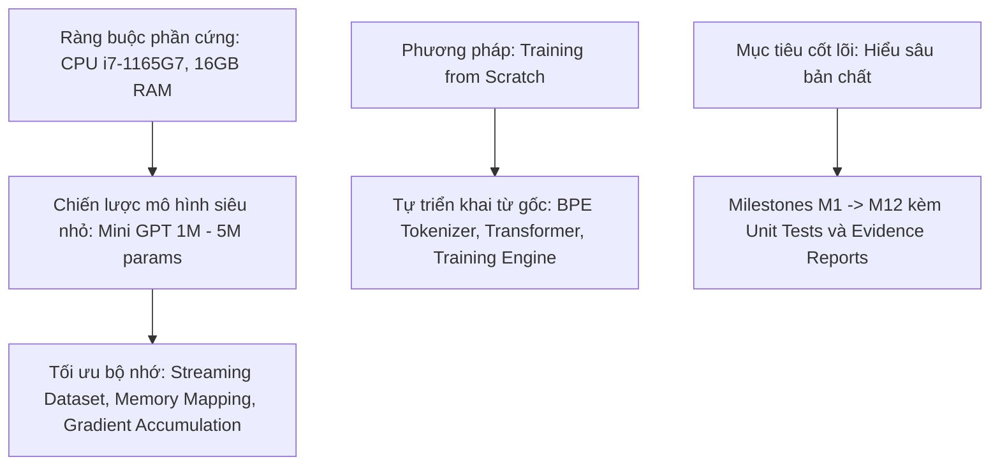
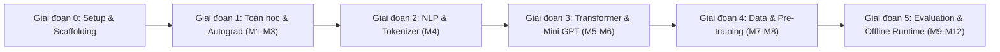
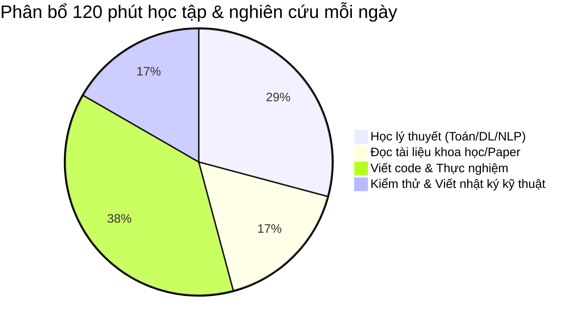

# Kế hoạch triển khai dự án Tuna-AI: Xây dựng mô hình ngôn ngữ lớn song ngữ từ đầu

> **Dự án**: Tuna-AI  
> **Phương pháp**: Training from scratch (trọng số ngẫu nhiên, không dùng pretrained weights)  
> **Ngôn ngữ mục tiêu**: Tiếng Việt và Tiếng Anh  
> **Nền tảng phần cứng**: Intel Core i7-1165G7, 16GB RAM, Iris Xe, 512GB SSD, Windows 11 (CPU execution)  
> **Thời gian dự kiến**: 12 - 18 tháng (~2 giờ/ngày)  

---

## 1. Phân tích Hiện trạng và Ràng buộc Kỹ thuật

### 1.1. Ràng buộc phần cứng & Chiến lược kỹ thuật
- **CPU Intel Core i7-1165G7 (4 cores / 8 threads)**: Không thể huấn luyện LLM hàng tỷ tham số. Chiến lược:
  - Bắt đầu với **Model A (~1M tham số)**: 2 layers, 2 heads, $d_{\text{model}} = 64$, context length 128, vocab 4K.
  - Tối ưu luồng tính toán: Giới hạn `torch.set_num_threads(4)` để tránh thermal throttling và cạnh tranh luồng hệ điều hành.
  - Sau khi đo lường RAM/Throughput khả thi mới nâng lên **Model B (~5M tham số)**.
- **16GB RAM**: Hệ điều hành và IDE chiếm ~4-6GB. Ngân sách khả dụng cho huấn luyện $\le 8\text{GB}$.
  - Tuyệt đối không nạp toàn bộ dataset vào RAM. Áp dụng cơ chế **Memory-mapped (`mmap`)** hoặc **Streaming Dataset** (`IterableDataset`).
  - Batch size nhỏ (8 - 16), kết hợp **Gradient Accumulation** (4 - 8 bước) để có effective batch size phù hợp.
- **512GB SSD**: Quản lý chặt dung lượng lưu trữ checkpoint (giới hạn số checkpoint gần nhất qua Checkpoint Manager).

### 1.2. Nguyên tắc triển khai cốt lõi
1. **Evidence before conclusions**: Không coi một module là "xong" nếu chưa có unit tests, log thực thi và dữ liệu kiểm chứng.
2. **Không dùng Pretrained Weights**: Toàn bộ trọng số được khởi tạo ngẫu nhiên (Gaussian/Xavier/Kaiming).
3. **Round-trip Integrity**: Tokenizer phải bảo toàn hoàn hảo văn bản song ngữ, không vỡ dấu tiếng Việt hay mất ký tự đặc biệt.

---

## 2. Lộ trình Phân kỳ 5 Giai đoạn Triển khai (Milestones M1 - M12)

---

### Giai đoạn 0: Thiết lập Hạ tầng & Chuẩn hóa Khung dự án (Sprint 0)
*Thời lượng: 3 - 5 ngày*

- **Mục tiêu**: Thiết lập cấu trúc thư mục chuẩn mực theo Section 16 của `MOTA.md`, cấu hình môi trường phát triển và Git.
- **Hạng mục công việc**:
  1. Khởi tạo Git repository và cấu hình `.gitignore` (loại trừ `data/raw`, `checkpoints/`, `__pycache__`, v.v.).
  2. Tạo môi trường ảo Python 3.11 (`venv`), cài đặt bộ phụ thuộc tối thiểu: `numpy`, `torch` (CPU wheel), `pytest`.
  3. Cấu hình thư mục dự án: `configs/`, `data/`, `research/`, `src/`, `experiments/`, `tests/`, `scripts/`, `checkpoints/`, `docs/`.
  4. Viết `pyproject.toml` chuẩn hóa gói `tuna`.

---

### Giai đoạn I: Nền tảng Toán học & Deep Learning từ đầu (Tháng 1 - 5 | M1 - M3)

#### Milestone M1: Đại số tuyến tính & Giải tích ứng dụng (Linear Algebra & Calculus)
- **Nội dung**: Vector, Matrix, Dot Product, Transpose, Norm, Broadcasting, Chain Rule, Gradient.
- **Sản phẩm bàn giao**:
  - `research/mathematics/linear_algebra.py`: Triển khai thủ công các phép toán ma trận bằng Python thuần và so sánh với NumPy.
  - `tests/test_linear_algebra.py`: Bộ kiểm thử độ chính xác số học.
- **Tiêu chí nghiệm thu**: 100% tests vượt qua; giải thích được cơ chế broadcasting và vectorization.

#### Milestone M2: Tự triển khai Automatic Differentiation Engine (Autograd)
- **Nội dung**: Computational Graph, Node, Value, Backward pass theo Chain Rule (tham khảo cấu trúc `micrograd`).
- **Sản phẩm bàn giao**:
  - `src/core/autograd.py`: Lớp `Scalar` / `Tensor` hỗ trợ `+`, `*`, `pow`, `relu`, `sigmoid`, `backward()`.
  - `tests/test_autograd.py`: Kiểm thử gradient bằng phương pháp **Finite Differences** ($[f(x+\epsilon) - f(x-\epsilon)] / 2\epsilon$) và đối chiếu với PyTorch `autograd`.
- **Tiêu chí nghiệm thu**: Sai số gradient so với PyTorch nhỏ hơn $10^{-5}$.

#### Milestone M3: Neural Network & Optimizer từ đầu
- **Nội dung**: Linear Layer, Multi-Layer Perceptron (MLP), Activation Functions, Loss Functions (MSE, Cross Entropy), SGD, AdamW.
- **Sản phẩm bàn giao**:
  - `research/deep_learning/mlp.py`: Tự huấn luyện MLP giải quyết bài toán phân loại và dự đoán chuỗi.
  - `research/deep_learning/optimizers.py`: Triển khai SGD with Momentum và AdamW.
- **Tiêu chí nghiệm thu**: MLP tự viết huấn luyện hội tụ trên bài toán phi tuyến (ví dụ: XOR, Spiral/Moons dataset).

---

### Giai đoạn II: Xử lý Ngôn ngữ Tự nhiên & Xây dựng BPE Tokenizer (Tháng 5 - 6 | M4)

#### Milestone M4: Hoàn thành Byte-level BPE Tokenizer song ngữ
- **Nội dung**: 
  - Khảo sát đặc thù tiếng Việt: Unicode NFC, 89 âm tiết dấu, từ ghép, ranh giới từ.
  - Khảo sát đặc thù tiếng Anh: Viết hoa/thường, tiền tố/hậu tố, dấu câu.
  - Thuật toán Byte-level Byte Pair Encoding (BPE) (tránh token out-of-vocabulary).
- **Sản phẩm bàn giao**:
  - `src/tokenizer/normalizer.py`: Bộ chuẩn hóa Unicode NFC và làm sạch khoảng trắng.
  - `src/tokenizer/bpe.py`: Thuật toán train merge pairs từ corpus thô.
  - `src/tokenizer/tokenizer.py`: Lớp `BilingualTokenizer` hỗ trợ: `train()`, `encode()`, `decode()`, `save()`, `load()`.
  - Quản lý Special Tokens: `<bos>`, `<eos>`, `<pad>`, `<unk>`.
  - `tests/test_tokenizer.py`: Round-trip test (`decode(encode(text)) == text`) trên 1.000 câu văn bản tiếng Việt và tiếng Anh.
- **Tiêu chí nghiệm thu**: 
  - Đạt kích thước vocabulary 8.000 - 16.000 tokens.
  - 100% round-trip lossless trên văn bản Unicode tiếng Việt có dấu và văn bản trộn ngữ.

---

### Giai đoạn III: Kiến trúc Transformer & Huấn luyện Mini GPT Thử nghiệm (Tháng 6 - 7 | M5 - M6)

#### Milestone M5: Triển khai Causal Transformer Decoder
- **Nội dung**:
  - Causal Self-Attention & Scaled Dot-Product Attention: $Attention(Q, K, V) = \text{softmax}\left(\frac{QK^T}{\sqrt{d_k}} + M\right)V$
  - Causal Masking (đảm bảo không rò rỉ token tương lai).
  - Multi-Head Attention (MHA).
  - Positional Embedding / RoPE (Rotary Position Embedding).
  - Pre-LayerNorm / RMSNorm và Feed-Forward Network (FFN).
- **Sản phẩm bàn giao**:
  - `src/models/attention.py`, `src/models/transformer.py`, `src/models/language_model.py`.
  - `tests/test_transformer.py`: Kiểm thử shape đầu ra, causal mask (đảm bảo gradient của token $t$ không phụ thuộc vào token $t+k$).
- **Tiêu chí nghiệm thu**: Model pass forward-backward check với PyTorch, tham số được khởi tạo ngẫu nhiên đúng quy chuẩn.

#### Milestone M6: Huấn luyện Mini GPT trên tập dữ liệu đồ chơi (Toy Corpus)
- **Nội dung**: 
  - Cấu hình Model A (~1M params: 2 layers, 2 heads, $d=64$, context 128).
  - Triển khai `TrainingEngine`: Forward pass, CrossEntropyLoss, Backward pass, AdamW, Gradient Clipping (`max_norm=1.0`), Checkpoint Manager (lưu model, optimizer, step, config).
  - Huấn luyện trên dataset nhỏ (ví dụ: tuyển tập truyện ngắn song ngữ hoặc Wikipedia tóm tắt).
- **Tiêu chí nghiệm thu**:
  - Training loss giảm ổn định (không bùng nổ gradient, không NaN).
  - Lưu và khôi phục checkpoint thành công, tiếp tục huấn luyện mà loss không bị gián đoạn.
  - Mô hình sinh ra được các chuỗi từ/câu có cấu trúc ngữ pháp cơ bản.

---

### Giai đoạn IV: Xây dựng Corpus Song ngữ & Pre-training Mô hình Chính (Tháng 7 - 10 | M7 - M8)

#### Milestone M7: Data Acquisition & Processing Pipeline *(Đã hoàn thành - Nghiệm thu Ngày 13)*
- **Nội dung**:
  - Nguồn dữ liệu hợp lệ: Wikipedia (Vi + En), OPUS parallel corpus, CC-100 subset.
  - Pipeline 10 bước: Acquisition $\to$ Extraction $\to$ Normalization $\to$ Language Detection $\to$ Deduplication (Exact & MinHash) $\to$ Quality Filter $\to$ Safety Filter $\to$ PII Removal $\to$ Tokenization $\to$ Dataset Packing.
  - Phân bổ corpus: 50% tiếng Việt - 50% tiếng Anh.
- **Sản phẩm bàn giao**:
  - `src/data/cleaner.py`, `src/data/pii_filter.py`, `src/data/deduplicator.py`, `src/data/packer.py`, `src/data/loader.py`.
  - File `manifest.json` ghi nhận nguồn gốc, giấy phép, hash, số bản ghi và số lượng token cho từng shard.
  - `tests/test_dataset_engineering.py`: Bộ kiểm thử 15 bài test tự động bao quát toàn bộ quy trình.
  - `research/dataset/build_bilingual_corpus.py`: Thực nghiệm trọn vẹn quy trình 10 bước.
  - Báo cáo kỹ thuật: `docs/weekly_reports/day_13_notes.md`.
- **Tiêu chí nghiệm thu**: Pipeline có khả năng tái lập hoàn toàn; loại bỏ trùng lặp và PII; xuất ra binary token chunks phục vụ nạp nhanh (86/86 tests toàn dự án passed 100%).

#### Milestone M8: Pre-training Mô hình Song ngữ & Kiểm thử Thí nghiệm *(Đã hoàn thành - Nghiệm thu Ngày 14)*
- **Nội dung**:
  - Huấn luyện mô hình từ random weights với streaming dataset và `ShardDataLoader` memmap uint16.
  - Thực hiện các thí nghiệm có kiểm soát:
    - `EXP-001`: Corpus thuần tiếng Anh (Loss: 6.2253 $\to$ 4.2727, PPL: 71.00).
    - `EXP-002`: Corpus thuần tiếng Việt (Loss: 6.2269 $\to$ 4.6122, PPL: 115.91).
    - `EXP-003`: Corpus song ngữ cân bằng 50/50 (Loss: 6.2269 $\to$ 4.8502, PPL: 137.82).
- **Sản phẩm bàn giao**:
  - `src/data/loader.py`: Nâng cấp `ShardDataLoader` bộ nạp memmap uint16 streaming chống tràn 16GB RAM.
  - `src/training/experiment.py`: Hệ thống quản lý và thực thi thí nghiệm `ExperimentRunner`.
  - `research/experiments/run_pretraining_experiments.py`: Kịch bản chạy toàn diện chuỗi thí nghiệm.
  - `experiments/reports/m8_pretraining_experiments.md` & `m8_metrics.json`: Báo cáo so sánh và chỉ số chi tiết.
  - `tests/test_pretraining_experiments.py`: Bộ kiểm thử đơn vị tự động.
  - Báo cáo kỹ thuật: `docs/weekly_reports/day_14_notes.md`.
- **Tiêu chí nghiệm thu**: Đo lường chi tiết token/s (~12.000 tok/s), mức chiếm dụng RAM (< 150 MB), Validation Loss, Perplexity và chất lượng sinh tự hồi quy; 89/89 tests toàn dự án passed 100%.

---

### Giai đoạn V: Đánh giá, Instruction Tuning & Offline Deployment (Tháng 10 - 18 | M9 - M12)

#### Milestone M9: Evaluation Engine & Benchmark Suite *(Đã hoàn thành - Nghiệm thu Ngày 15)*
- **Nội dung**: Xây dựng harness đánh giá độc lập:
  - Định lượng: CrossEntropy Loss (4.4016), Perplexity (81.59), Next-Token Top-1 (3.44%) & Top-5 Accuracy (19.38%).
  - Benchmark song ngữ Cloze Test: Đánh giá khả năng hiểu ngữ cảnh tiếng Việt và tiếng Anh.
  - Đo lường Inference Latency: TTFT (2.48 ms), ITL (2.05 ms/token), Generation Throughput (482.99 tok/s), RAM (< 300 MB).
- **Sản phẩm bàn giao**:
  - `src/evaluation/benchmarks.py`: Bộ benchmark song ngữ `ClozeBenchmark`.
  - `src/evaluation/evaluator.py`: Động cơ đánh giá toàn diện `ModelEvaluator`.
  - `research/evaluation/run_evaluation.py`: Kịch bản thực thi đánh giá hoàn chỉnh.
  - `experiments/reports/m9_evaluation_report.md` & `m9_eval_metrics.json`: Báo cáo định lượng chi tiết.
  - `tests/test_evaluation.py`: Bộ kiểm thử tự động 5/5 bài test.
  - Báo cáo kỹ thuật: `docs/weekly_reports/day_15_notes.md`.
- **Tiêu chí nghiệm thu**: Test set độc lập, không rò rỉ vào training set; harness tự động hóa hoàn toàn; 94/94 tests toàn dự án passed 100%.

#### Milestone M10: Instruction Tuning (SFT)
- **Nội dung**:
  - Bộ dữ liệu hội thoại mẫu dạng Chat (`role`: `system`, `user`, `assistant`).
  - Chat Template định dạng rõ ranh giới lượt trò chuyện.
  - Áp dụng **Response Masking**: Chỉ tính loss trên phần trả lời của Assistant, không tính loss trên prompt của User.
- **Tiêu chí nghiệm thu**: Mô hình biết dừng lượt (`<eos>`) và phản hồi theo định dạng hỏi - đáp thay vì chỉ tiếp nối văn bản tự do.

#### Milestone M11: Inference Engine Offline & Tối ưu CPU
- **Nội dung**:
  - Bộ sinh văn bản (`src/inference/generator.py`): Greedy Search, Temperature, Top-K, Top-P (Nucleus Sampling), Repetition Penalty.
  - Nghiên cứu và đo đạc **KV Cache** trên CPU xem có cải thiện độ trễ mỗi token hay không.
  - Đóng gói định dạng mô hình: `safetensors` + `config.json` + `tokenizer.json` + `model_card.md`.
- **Tiêu chí nghiệm thu**: Chạy inference offline 100% không cần kết nối mạng trên máy tính i7-1165G7.

#### Milestone M12: Model Serving API & Tài liệu Tổng kết
- **Nội dung**:
  - Viết REST API cục bộ bằng FastAPI: `/v1/generate`, `/v1/chat/completions`, `/health`.
  - Hoàn thiện tài liệu kỹ thuật, hướng dẫn cài đặt và vận hành.
- **Tiêu chí nghiệm thu**: API phục vụ phản hồi ổn định với curl/Postman; tài liệu đầy đủ để người khác có thể dựng lại dự án từ đầu.

---

## 3. Kế hoạch Hành động Tuần Đầu Tiên (Week 1 Action Plan)

Theo hướng dẫn tại Mục 19 của `MOTA.md`, tuần 1 tập trung thiết lập dự án và nền tảng toán học (chưa đụng tới Transformer):

| Ngày | Nội dung học & triển khai | Sản phẩm cụ thể | Kiểm chứng |
| :--- | :--- | :--- | :--- |
| **Ngày 1** | Khởi tạo repo, Virtualenv, cài đặt NumPy/PyTorch/Pytest. Học Scalar, Vector, Matrix, Tensor. | Cấu trúc thư mục dự án; script `research/mathematics/vectors_matrices.py`. | Chạy được phép cộng, nhân vô hướng, reshape bằng NumPy. |
| **Ngày 2** | Dot Product và Matrix Multiplication. | Viết hàm `matrix_multiply()` thủ công (vòng lặp 3 lớp) và so sánh kết quả/tốc độ với `numpy.dot()`. | Đo chênh lệch thời gian thực thi (vectorization benchmark). |
| **Ngày 3** | Transpose, Norm, Distance, Broadcasting Rules. | Bộ unit tests kiểm tra broadcasting và tính norm vector/ma trận. | `pytest tests/test_linear_algebra.py` pass 100%. |
| **Ngày 4** | Giải tích: Function, Derivative, Partial Derivative, Gradient. | Viết script tính đạo hàm giải tích và so sánh với đạo hàm số trị (finite differences). | Sai số giải tích vs số trị $< 10^{-6}$. |
| **Ngày 5** | Chain Rule và Computational Graph cơ bản. | Triển khai đồ thị tính toán 3 nút cơ bản với forward và backward pass thủ công. | Giá trị gradient của biến đầu vào khớp với lý thuyết vi phân. |
| **Ngày 6** | Tối ưu hóa: Gradient Descent cơ bản. | Triển khai mô hình Linear Regression từ đầu giải bài toán fit đường thẳng bằng Gradient Descent. | Hàm loss giảm đều theo từng epoch; trọng số hội tụ về giá trị mục tiêu. |
| **Ngày 7** | Đánh giá tuần & Viết báo cáo thực nghiệm. | Tổng hợp code, hoàn thiện test suite, viết `docs/weekly_reports/week_01.md`. | Review lại các khái niệm chưa nắm vững, chuẩn bị kế hoạch tuần 2. |

---

## 4. Quản lý Thời gian Hàng ngày (Daily Schedule 2h)

- **Mỗi tuần**: Dành 30 phút ngày Chủ Nhật để tổng kết 6 câu hỏi:
  1. *Kiến thức nào đã hiểu thấu đáo?*
  2. *Khái niệm nào còn mơ hồ cần tra cứu lại?*
  3. *Implementation nào đã hoàn tất và vượt qua tests?*
  4. *Gặp lỗi gì (numerical instability, out-of-memory, shape mismatch) và cách khắc phục?*
  5. *Kết quả thực nghiệm có tính tái lập (reproducible) không?*
  6. *Kế hoạch tuần tới cần điều chỉnh gì cho phù hợp với tốc độ thực tế?*

---

## 5. Ma trận Rủi ro & Giải pháp Phòng ngừa

| Rủi ro kỹ thuật | Mức độ | Tác động | Giải pháp phòng ngừa / Khắc phục |
| :--- | :---: | :--- | :--- |
| **Tràn bộ nhớ RAM (OOM)** khi huấn luyện | Cao | Tiến trình bị OS kill, mất dữ liệu chưa lưu | Tuyệt đối không đọc toàn bộ corpus vào RAM. Dùng `mmap` / streaming generator. Giới hạn batch size và sequence length. |
| **Thermal Throttling CPU** (CPU quá nóng) | Cao | Tốc độ tính toán giảm mạnh, máy bị đơ | Giới hạn số worker (`num_workers <= 2`), giới hạn số luồng tính toán `torch.set_num_threads(4)`, chạy thí nghiệm theo từng chunk nhỏ. |
| **Gradient Vanishing / Exploding** | Trung bình | Loss biến thành `NaN` hoặc không hội tụ | Triển khai Gradient Clipping (`torch.nn.utils.clip_grad_norm_`), khởi tạo trọng số chuẩn (Xavier/Kaiming), dùng Pre-LN / RMSNorm. |
| **Vỡ ký tự tiếng Việt trong Tokenizer** | Trung bình | Suy giảm năng lực biểu diễn tiếng Việt | Áp dụng Byte-level BPE; chuẩn hóa Unicode NFC thống nhất; kiểm tra round-trip encode-decode trên toàn bộ bảng chữ cái có dấu. |
| **Thiếu kiểm chứng tái lập (Non-reproducible)** | Thấp | Không thể so sánh giữa các thí nghiệm | Khóa cố định Random Seed (`random`, `numpy`, `torch`); lưu cấu hình đầy đủ trong `configs/` và checkpoint. |

---

## 6. Các bước Đề xuất Thực hiện Ngay

1. **Bước 1**: Khởi tạo Git repo và bộ khung thư mục theo chuẩn Section 16 `MOTA.md`.
2. **Bước 2**: Tạo môi trường ảo Python 3.11, file `pyproject.toml` hoặc `requirements.txt`.
3. **Bước 3**: Khởi động Ngày 1 của Kế hoạch Tuần 1: viết các bài thực hành đại số tuyến tính cơ bản và unit tests.
