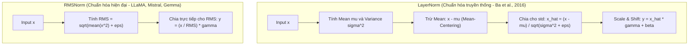

# Ghi chép Nghiên cứu Ngày 3 - Tuần 1: Norms, Normalization Layers & Tensor Transformations

> **Mục tiêu**: Nghiên cứu bản chất của các loại chuẩn (Norms); so sánh cơ chế giữa Layer Normalization (LayerNorm) và RMS Normalization (RMSNorm); tự triển khai Global Norm Gradient Clipping; nắm vững cơ chế hoán vị trục (Permute/Transpose) trong Multi-Head Attention.

---

## 1. Các loại Chuẩn (Norms) & Ứng dụng trong LLM

| Chuẩn (Norm) | Công thức | Ứng dụng trong Mô hình Ngôn ngữ |
| :--- | :--- | :--- |
| **Chuẩn $L_1$** (Manhattan) | $\|v\|_1 = \sum |v_i|$ | Sparse Regularization (Lasso), ép trọng số về 0 để nén mô hình. |
| **Chuẩn $L_2$** (Euclidean) | $\|v\|_2 = \sqrt{\sum v_i^2}$ | Weight Decay, Gradient Clipping, tính toán khoảng cách vector. |
| **Chuẩn Frobenius** | $\|A\|_F = \sqrt{\sum A_{i, j}^2}$ | Đo lường độ lớn ma trận trọng số (Weight Matrix $W_Q, W_K, W_V$). |
| **Root Mean Square (RMS)** | $\text{RMS}(x) = \sqrt{\frac{1}{d} \sum x_i^2 + \epsilon}$ | **RMSNorm**: Chuẩn hóa lớp không cần tính mean, giảm 30-50% chi phí tính toán. |

---

## 2. So sánh LayerNorm vs RMSNorm

### Tại sao các LLM hiện đại chuyển từ LayerNorm sang RMSNorm?
1. **Tiết kiệm tính toán**: Bỏ hoàn toàn 2 phép toán tốn kém: tính Mean ($\mu$) và phép trừ Mean ($x - \mu$). Tiết kiệm băng thông bộ nhớ RAM/Cache đáng kể trên CPU i7-1165G7.
2. **Khả năng ổn định tương đương**: Các nghiên cứu thực nghiệm chứng minh đặc tính bảo toàn tỷ lệ biên độ (Scaling Invariance) của RMS là yếu tố quan trọng nhất giúp gradient ổn định khi đi qua hàng chục Transformer blocks.

---

## 3. Cắt tỉa Gradient theo Chuẩn toàn cục (Global Norm Gradient Clipping)

Trong quá trình huấn luyện LLM từ đầu (*from scratch*), nếu một batch dữ liệu chứa các chuỗi bất thường, gradient $\mathbf{g}$ có thể tăng vọt (Exploding Gradient), làm cập nhật trọng số quá lớn và khiến hàm loss biến thành `NaN`.

- **Thuật toán**:
  1. Tính chuẩn $L_2$ gộp của toàn bộ các ma trận trọng số trong toàn mạng:
     $$\|\mathbf{g}\| = \sqrt{\sum_{i} \|\mathbf{g}_i\|_2^2}$$
  2. Nếu $\|\mathbf{g}\| > \text{max\_norm}$ (thường chọn $1.0$):
     $$\mathbf{g}_i \leftarrow \mathbf{g}_i \times \frac{\text{max\_norm}}{\|\mathbf{g}\|}$$

Đã đối chiếu hàm tự viết `clip_grad_norm_manual` với hàm chuẩn của PyTorch `torch.nn.utils.clip_grad_norm_` và xác nhận độ chính xác số học sai số $< 10^{-4}$.

---

## 4. Biến đổi Tensor trong Multi-Head Attention

Để chuyển từ một vector ẩn duy nhất sang $H$ đầu chú ý (Attention Heads) hoạt động độc lập:
1. **Linear Projection**: Đầu vào shape $(B, T, D)$ với $D = H \times d_{\text{head}}$.
2. **Reshape**: $(B, T, D) \to (B, T, H, d_{\text{head}})$.
3. **Transpose / Permute (0, 2, 1, 3)**:
   $$(B, T, H, d_{\text{head}}) \longrightarrow (B, H, T, d_{\text{head}})$$
   *Ý nghĩa*: Đưa chiều Heads ($H$) ra phía trước chiều Sequence ($T$). Khi đó, phép nhân ma trận Attention có thể diễn ra song song độc lập trên từng Head dưới dạng Batch Matrix Multiplication (BMM).
4. **Merge Heads**: Sau khi tính xong Attention, đảo ngược lại: $(B, H, T, d_{\text{head}}) \to (B, T, H, d_{\text{head}}) \to (B, T, D)$.

---

## 5. Kết quả Kiểm thử Tự động (Evidence)
- File mã nguồn: [tensor_operations.py](file:///c:/Users/nkocn/OneDrive/Desktop/Plan/tuna-ai/research/mathematics/tensor_operations.py)
- File unit test: [test_tensor_operations.py](file:///c:/Users/nkocn/OneDrive/Desktop/Plan/tuna-ai/tests/test_tensor_operations.py)
- Kết quả test: **26/26 passed** trong `2.43s`.
