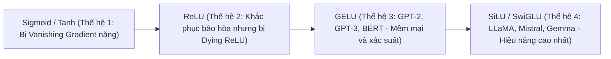

# Ghi chép Nghiên cứu Ngày 4 - Tuần 1: Giải tích ứng dụng & Đạo hàm các Hàm Kích hoạt

> **Mục tiêu**: Nắm vững bản chất giải tích của đạo hàm và gradient; phân tích hiện tượng triệt tiêu gradient (Vanishing Gradient); tìm hiểu sự tiến hóa của các hàm kích hoạt từ Sigmoid $\to$ ReLU $\to$ GELU $\to$ SiLU/SwiGLU; chứng minh công thức gradient kỳ diệu của Softmax Cross-Entropy; ứng dụng phương pháp kiểm thử Gradient Checking bằng sai phân hữu hạn (Finite Differences).

---

## 1. Sự tiến hóa của các Hàm Kích hoạt (Activation Functions) trong LLM

| Hàm kích hoạt | Công thức $f(x)$ | Đạo hàm $f'(x)$ | Phân tích ưu / nhược điểm |
| :--- | :--- | :--- | :--- |
| **Sigmoid** | $\sigma(x) = \frac{1}{1 + e^{-x}}$ | $\sigma(x)(1 - \sigma(x))$ | $f'(x) \le 0.25$. Khi $|x| > 4$, đạo hàm $\to 0$ khiến gradient bị triệt tiêu sau vài tầng mạng. |
| **Tanh** | $\frac{e^x - e^{-x}}{e^x + e^{-x}}$ | $1 - \tanh^2(x)$ | Bị bão hòa hai đầu tương tự Sigmoid, nhưng zero-centered tốt hơn. |
| **ReLU** | $\max(0, x)$ | $1$ nếu $x > 0$ else $0$ | Không bão hòa ở nhánh dương $\to$ huấn luyện nhanh. Nhược điểm: "Dying ReLU" (neuron chết nếu rơi vào miền âm). |
| **GELU** | $x \Phi(x) = 0.5x(1 + \text{erf}(\frac{x}{\sqrt{2}}))$ | $\Phi(x) + x \phi(x)$ | Cân nhắc giữa độ lớn và xác suất kích hoạt của neuron. Đạo hàm phi tuyến mượt mà ở mọi điểm. |
| **SiLU (Swish)** | $x \cdot \sigma(x)$ | $\sigma(x)[1 + x(1 - \sigma(x))]$ | Lõi của **SwiGLU** trong các mô hình nguồn mở hiện đại nhất hiện nay. Đạt độ hội tụ loss pre-training tốt hơn GELU. |

---

## 2. Gradient của Softmax Cross-Entropy — Trái tim của Huấn luyện LLM

Trong Transformer Decoder, mục tiêu huấn luyện là dự đoán token tiếp theo (Next-Token Prediction):
1. **Đầu ra logits**: $\mathbf{z} \in \mathbb{R}^{V}$ (trong đó $V$ là kích thước từ vựng vocab size).
2. **Phân phối xác suất Softmax**:
   $$p_i = \frac{e^{z_i}}{\sum_{j=1}^V e^{z_j}}$$
3. **Hàm mất mát Cross-Entropy**:
   $$L = -\sum_{i=1}^V y_i \log(p_i) = -\log(p_{\text{target}})$$
   (với $y$ là one-hot vector: $y_{\text{target}} = 1$, các vị trí khác bằng $0$).

### Chứng minh công thức Gradient:
Đạo hàm của $L$ theo logit $z_i$:
$$\frac{\partial L}{\partial z_i} = p_i - y_i$$
- Nếu $i = \text{target}$: $\frac{\partial L}{\partial z_{\text{target}}} = p_{\text{target}} - 1$ (khi mô hình đoán tự tin $p \to 1$, gradient tiến về $0$).
- Nếu $i \neq \text{target}$: $\frac{\partial L}{\partial z_i} = p_i - 0 = p_i$ (đẩy xác suất của các từ sai xuống).

> [!NOTE]
> Kết quả $\frac{\partial L}{\partial z} = \mathbf{p} - \mathbf{y}$ cực kỳ đơn giản và thanh lịch: **Độ lỗi truyền ngược chính là khoảng cách giữa phân phối dự đoán của mô hình và nhãn thực tế!**

---

## 3. Kỹ thuật Kiểm thử Gradient Checking (Finite Differences)

Để đảm bảo đạo hàm giải tích (Analytical Gradients) không bị sai dấu hoặc sai hệ số, ta dùng công thức sai phân trung tâm (Central Difference):
$$f'(x) \approx \frac{f(x + \epsilon) - f(x - \epsilon)}{2\epsilon} \quad (\text{với } \epsilon = 10^{-6})$$

- Sai số tương đối (Relative Error):
  $$\text{Relative Error} = \frac{|g_{\text{analytical}} - g_{\text{numerical}}|}{\max(|g_{\text{analytical}}|, |g_{\text{numerical}}|) + 10^{-8}}$$
- Tiêu chí: Mọi hàm kích hoạt và hàm loss đều đạt Relative Error $< 10^{-5}$ trong toàn bộ bài kiểm thử tự động.

---

## 4. Kết quả Kiểm thử (Evidence)
- File mã nguồn: [calculus_derivatives.py](file:///c:/Users/nkocn/OneDrive/Desktop/Plan/tuna-ai/research/mathematics/calculus_derivatives.py)
- File unit test: [test_calculus_derivatives.py](file:///c:/Users/nkocn/OneDrive/Desktop/Plan/tuna-ai/tests/test_calculus_derivatives.py)
- Kết quả test: **33/33 passed** (toàn bộ test Ngày 1, 2, 3, 4).
