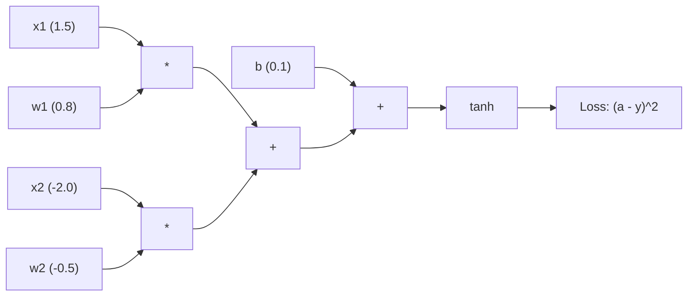

# Ghi chép Nghiên cứu Ngày 5 - Tuần 1: Chain Rule & Computational Graph (Autograd Engine)

> **Mục tiêu**: Hiểu bản chất hoạt động của Động cơ Tự động Vi phân (Autograd Engine); xây dựng Đồ thị Tính toán có hướng không chu trình (DAG); triển khai thuật toán Sắp xếp Tô-pô (Topological Sort); áp dụng Quy tắc Dây chuyền (Chain Rule) tự động tính toán gradient cho mạng nơ-ron nhân tạo.

---

## 1. Đồ thị Tính toán (Computational Graph - DAG)

Trong Deep Learning, mọi biểu thức toán học đều có thể biểu diễn dưới dạng một đồ thị có hướng không chu trình (Directed Acyclic Graph):
- **Các nút lá (Leaf Nodes)**: Đại diện cho dữ liệu đầu vào ($x$) và trọng số tham số ($w, b$).
- **Các nút trung gian (Internal Nodes)**: Đại diện cho các phép toán nguyên tử (`+`, `*`, `pow`, `relu`, `sigmoid`, `tanh`).
- **Nút gốc (Root Node)**: Giá trị hàm mất mát vô hướng (Scalar Loss $L$).



---

## 2. Quy tắc Dây chuyền & Cơ chế Tích lũy Gradient (`+=`)

### 2.1. Quy tắc Dây chuyền Nhiều biến (Multivariate Chain Rule)
Nếu một biến $x$ ảnh hưởng đến hàm mất mát $L$ thông qua nhiều biến trung gian $y_1, y_2, \dots, y_k$:
$$\frac{\partial L}{\partial x} = \sum_{i=1}^k \frac{\partial L}{\partial y_i} \frac{\partial y_i}{\partial x}$$

### 2.2. Điểm chết người khi viết Autograd: `self.grad += ...` thay vì `=`
Xét biểu thức $f = x + x$:
- Nếu viết `self.grad = out.grad * 1.0`, nút $x$ sẽ bị gán đè gradient từ nhánh thứ hai, kết quả ra $\frac{df}{dx} = 1.0$ (**Sai**).
- Với `self.grad += 1.0 * out.grad`, gradient từ cả hai nhánh được cộng dồn: $\frac{df}{dx} = 1.0 + 1.0 = 2.0$ (**Đúng tuyệt đối**).

---

## 3. Thuật toán Sắp xếp Tô-pô (Topological Sort)

Để hàm `backward()` tính toán chính xác, thứ tự thực thi phải duyệt ngược từ nút Loss về nút Input, đảm bảo **mọi nút cha phụ thuộc vào nút hiện tại phải được tính gradient đầy đủ trước khi nút hiện tại truyền ngược gradient về các nút con**.

Thuật toán duyệt theo chiều sâu (DFS - Depth First Search):
```python
topo = []
visited = set()

def build_topo(v):
    if v not in visited:
        visited.add(v)
        for child in v._prev:
            build_topo(child)
        topo.append(v)

build_topo(loss_node)

# Duyệt ngược để tính đạo hàm:
loss_node.grad = 1.0
for node in reversed(topo):
    node._backward()
```

---

## 4. Bằng chứng Đối chiếu với PyTorch Autograd (Evidence)

Đã mô phỏng nơ-ron nhân tạo $a = \tanh(x_1 w_1 + x_2 w_2 + b)$ và so sánh với `torch.autograd`:

| Tham số | Giá trị khởi tạo | Gradient tự viết (Scalar) | Gradient PyTorch Autograd | Sai số tuyệt đối |
| :---: | :---: | :---: | :---: | :---: |
| **$w_1$** | $0.8$ | **$-0.176465$** | **$-0.176465$** | $< 10^{-6}$ |
| **$w_2$** | $-0.5$ | **$+0.235287$** | **$+0.235287$** | $< 10^{-6}$ |
| **$b$** | $0.1$ | **$-0.117643$** | **$-0.117643$** | $< 10^{-6}$ |

---

## 5. Kết quả Kiểm thử (Evidence)
- File mã nguồn: [autograd.py](file:///c:/Users/nkocn/OneDrive/Desktop/Plan/tuna-ai/src/core/autograd.py)
- File unit test: [test_autograd.py](file:///c:/Users/nkocn/OneDrive/Desktop/Plan/tuna-ai/tests/test_autograd.py)
- Kết quả test: **38/38 passed** trong `2.50s`.
