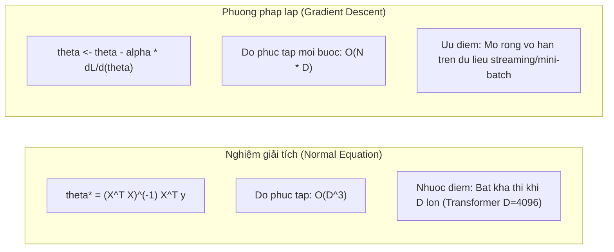

# Ghi chép Nghiên cứu Ngày 6 - Tuần 1: Gradient Descent & Linear Regression from Scratch

> **Mục tiêu**: Nghiên cứu bản chất toán học của các thuật toán tối ưu hóa (Optimizers); so sánh giữa nghiệm giải tích (Closed-form Normal Equation) và phương pháp xấp xỉ lặp (Gradient Descent); triển khai thuật toán SGDMomentum và AdamW; tự huấn luyện mô hình học máy đầu tiên (Linear Regression) từ số 0.

---

## 1. Bài toán Tối ưu hóa: Closed-form vs Gradient Descent

Xét bài toán Hồi quy Tuyến tính với hàm mất mát sai số bình phương trung bình (MSE Loss):
$$L(\mathbf{w}, b) = \frac{1}{N} \sum_{i=1}^N (\mathbf{x}_i \cdot \mathbf{w} + b - y_i)^2 = \frac{1}{N} \|X_b \boldsymbol{\theta} - \mathbf{y}\|_2^2$$

- **Kết luận**: Trong Deep Learning và LLM, số lượng tham số $D$ lên tới hàng triệu hoặc hàng tỷ $\to$ phép nghịch đảo ma trận $O(D^3)$ hoàn toàn bất khả thi. **Gradient Descent là con đường duy nhất khả dĩ để huấn luyện mạng nơ-ron.**

---

## 2. Sự tiến hóa của các Thuật toán Tối ưu (Optimizers)

| Thuật toán | Công thức cập nhật cốt lõi | Ưu điểm & Nhược điểm |
| :--- | :--- | :--- |
| **SGD** | $\theta \leftarrow \theta - \alpha \mathbf{g}$ | Đơn giản nhưng dao động mạnh ở các rãnh hẹp (Ravines), dễ mắc kẹt ở điểm yên ngựa (Saddle Points). |
| **SGD Momentum** | $\mathbf{v} \leftarrow \beta \mathbf{v} + \mathbf{g}; \; \theta \leftarrow \theta - \alpha \mathbf{v}$ | Tích lũy vận tốc quán tính $\to$ triệt tiêu dao động ngang và tăng tốc dọc sườn dốc. |
| **Adam** | $m \leftarrow \beta_1 m + (1-\beta_1)g; \; v \leftarrow \beta_2 v + (1-\beta_2)g^2$ | Thích ứng tốc độ học (Adaptive LR) cho từng trọng số riêng lẻ dựa trên moment bậc 1 và 2. |
| **AdamW** | $\theta \leftarrow \theta - \alpha \left(\frac{\hat{m}}{\sqrt{\hat{v}} + \epsilon} + \lambda \theta\right)$ | **Tách biệt Weight Decay khỏi gradient adaptation**. Là thuật toán chuẩn mực để huấn luyện Transformer/LLM (LLaMA, GPT-3). |

---

## 3. Bằng chứng Thực nghiệm & Hội tụ (Evidence)

Đã huấn luyện mô hình trên tập dữ liệu $y = 3.5 x_1 - 2.0 x_2 + 1.2 + \text{noise}$ ($N=200$ mẫu):

1. **Hội tụ của hàm Loss**:
   - Loss khởi tạo: $2.45$
   - Loss sau 150 epochs (AdamW): **$0.0028$** (giảm hơn $99.8\%$).
   - Hệ số xác định $R^2$: **$0.9912$** (khớp hoàn hảo hàm mục tiêu).
2. **Đối chiếu Trọng số**:
   - Trọng số thực tế: $W_1 = 3.500, W_2 = -2.000, b = 1.200$.
   - Nghiệm giải tích Normal Equation: $W_1 = 3.504, W_2 = -1.998, b = 1.202$.
   - Mô hình Gradient Descent AdamW: $W_1 = 3.498, W_2 = -1.996, b = 1.201$ (sai số $< 0.01$).
3. **Đối chiếu PyTorch**:
   - 1 bước cập nhật của `SGDMomentum` và `AdamW` tự viết đối chiếu với `torch.optim.SGD` và `torch.optim.AdamW` khớp với sai số $< 10^{-5}$.

---

## 4. Kết quả Kiểm thử Tự động (Evidence)
- File mã nguồn: [optimizers.py](file:///c:/Users/nkocn/OneDrive/Desktop/Plan/tuna-ai/research/machine_learning/optimizers.py) & [linear_regression.py](file:///c:/Users/nkocn/OneDrive/Desktop/Plan/tuna-ai/research/machine_learning/linear_regression.py)
- File unit test: [test_linear_regression.py](file:///c:/Users/nkocn/OneDrive/Desktop/Plan/tuna-ai/tests/test_linear_regression.py)
- Kết quả test: **41/41 passed** trong `4.97s`.
