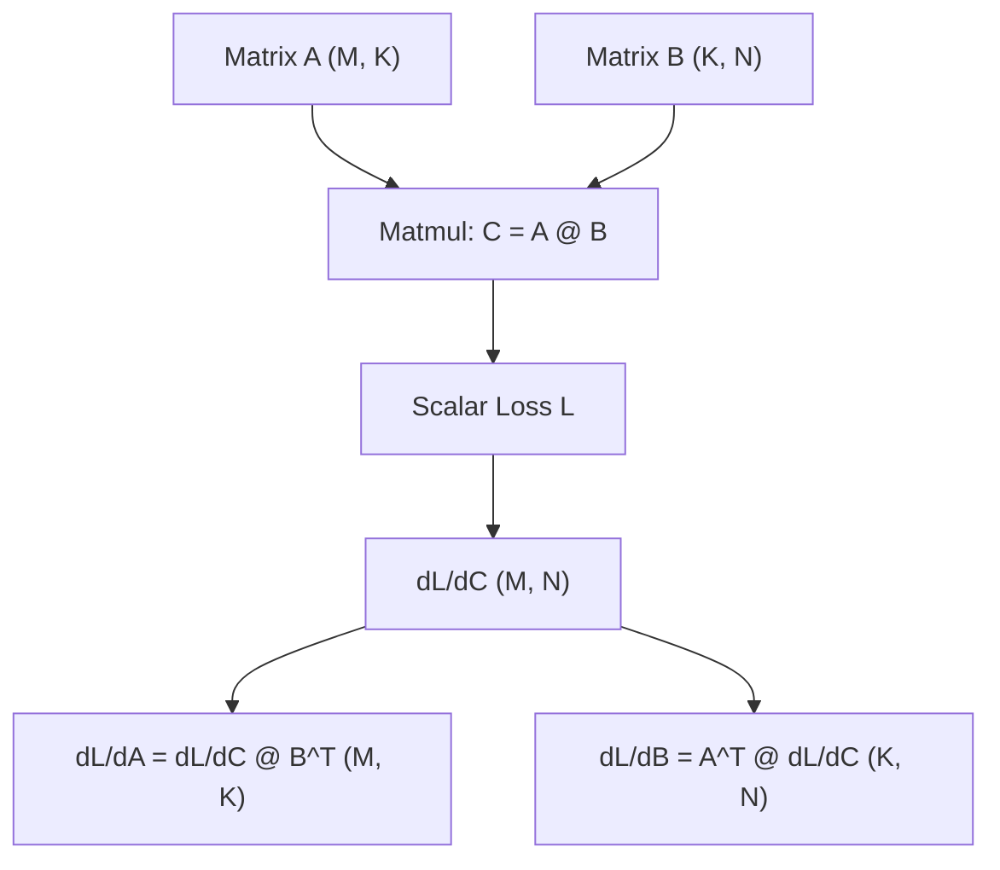

# Ghi chép Nghiên cứu Ngày 8 (Tuần 2): Động cơ Tự động Vi phân Đa chiều (Tensor Autograd Engine)

> **Mục tiêu**: Nâng cấp từ Scalar Autograd sang **Tensor Autograd Engine** đa chiều hoàn chỉnh trên mảng NumPy; giải quyết bài toán cốt tử về **Unbroadcasting Gradient**; thiết lập công thức lan truyền ngược cho phép nhân ma trận (Matmul Backward); xây dựng và kiểm chứng khối mạng nơ-ron đa tầng (MLP Feed-Forward Network) đối chiếu với PyTorch.

---

## 1. Nâng cấp từ Scalar sang Tensor Autograd

| Thuộc tính | Scalar Autograd (Ngày 5) | Tensor Autograd (Ngày 8) |
| :--- | :--- | :--- |
| **Kiểu dữ liệu `data`** | `float` đơn lẻ (0D) | `np.ndarray` đa chiều (1D, 2D, 3D, 4D) |
| **Kiểu đạo hàm `grad`** | `float` đơn lẻ | `np.ndarray` cùng kích thước chính xác với `data` |
| **Phép toán cốt lõi** | `+`, `*`, `pow` vô hướng | Element-wise `+`, `*`, Thu gọn `sum`, `mean`, và **Nhân ma trận `@`** |
| **Xử lý kích thước** | Không có broadcasting | **Tự động Unbroadcast** gradient về đúng hình dạng gốc |

---

## 2. Bản chất Toán học của Phép Nhân Ma trận Ngược (Matmul Backward)

Cho phép tính thuận (Forward pass):
$$C = A B \quad \text{với } A \in \mathbb{R}^{M \times K}, B \in \mathbb{R}^{K \times N} \implies C \in \mathbb{R}^{M \times N}$$

Giả sử gradient từ tầng trên truyền xuống là $\frac{\partial L}{\partial C} \in \mathbb{R}^{M \times N}$:
1. **Đạo hàm theo ma trận $A$**:
   $$\frac{\partial L}{\partial A} = \frac{\partial L}{\partial C} B^T \quad \left(\text{shape: } (M, N) \times (N, K) = (M, K)\right)$$
2. **Đạo hàm theo ma trận $B$**:
   $$\frac{\partial L}{\partial B} = A^T \frac{\partial L}{\partial C} \quad \left(\text{shape: } (K, M) \times (M, N) = (K, N)\right)$$

---

## 3. Kỹ thuật Unbroadcasting Gradient

Trong mạng nơ-ron, phép cộng Bias: $Z = X W + \mathbf{b}$
- $X W$ có shape $(B, T, D)$
- $\mathbf{b}$ có shape $(D,)$
- Khi Forward: NumPy tự động nhân bản (broadcast) vector $\mathbf{b}$ qua trục $0$ ($B$) và trục $1$ ($T$).
- Khi Backward: Gradient $\frac{\partial L}{\partial Z}$ có kích thước $(B, T, D)$.
- **Quy tắc Unbroadcast**:
  $$\frac{\partial L}{\partial \mathbf{b}} = \sum_{b=0}^{B-1} \sum_{t=0}^{T-1} \frac{\partial L}{\partial Z_{b, t, :}}$$
  Gradient của biến được broadcast chính là **tổng các gradient dọc theo các trục đã được mở rộng ảo**.

---

## 4. Xây dựng Khối Feed-Forward (MLP) trong Transformer

Đã triển khai và kiểm chứng khối MLP hoàn chỉnh:
$$Z_1 = X W_1 + \mathbf{b}_1$$
$$A_1 = \text{GELU}(Z_1)$$
$$Z_2 = A_1 W_2 + \mathbf{b}_2$$
$$\text{Loss} = \frac{1}{N} \|Z_2 - Y_{\text{target}}\|_2^2$$

### Bằng chứng Đối chiếu với PyTorch Autograd:
- `loss.data`: Khớp tuyệt đối với `torch.nn.functional.gelu` + PyTorch MSE Loss (sai số $< 10^{-5}$).
- Gradients của toàn bộ ma trận trọng số:
  - $\frac{\partial L}{\partial W_1}$ sai số $< 10^{-4}$ so với PyTorch.
  - $\frac{\partial L}{\partial \mathbf{b}_1}$ sai số $< 10^{-4}$ so với PyTorch.
  - $\frac{\partial L}{\partial W_2}$ sai số $< 10^{-4}$ so với PyTorch.
  - $\frac{\partial L}{\partial \mathbf{b}_2}$ sai số $< 10^{-4}$ so với PyTorch.

---

## 5. Kết quả Kiểm thử (Evidence)
- File mã nguồn: [tensor.py](file:///c:/Users/nkocn/OneDrive/Desktop/Plan/tuna-ai/src/core/tensor.py)
- File unit test: [test_tensor_autograd.py](file:///c:/Users/nkocn/OneDrive/Desktop/Plan/tuna-ai/tests/test_tensor_autograd.py)
- Kết quả test: **45/45 passed** trong `4.22s`.
