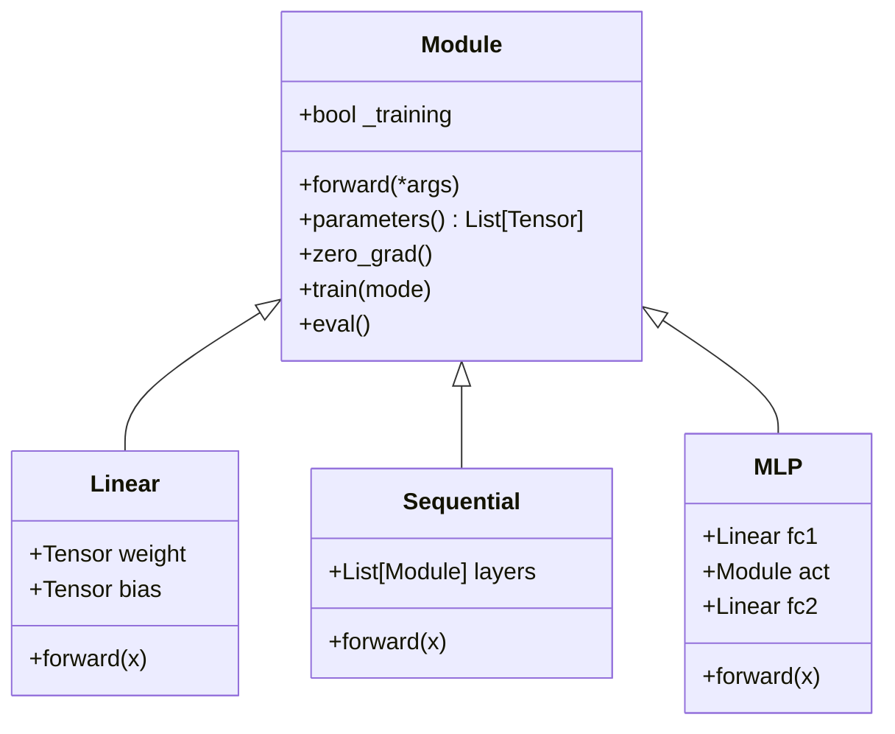

# Ghi chép Nghiên cứu Ngày 9 (Tuần 2): Mạng Nơ-ron Đa tầng (MLP) & Nghiệm thu Cột mốc Milestone M3

> **Mục tiêu**: Xây dựng kiến trúc module hóa hướng đối tượng `Module` (tương tự `torch.nn.Module`); nắm vững nguyên lý khởi tạo trọng số Kaiming/He; tự xây dựng các tầng `Linear`, `Sequential`, `MLP` và hàm mất mát `BCEWithLogitsLoss`; chứng minh Định lý Xấp xỉ Phổ quát (Universal Approximation Theorem) bằng cách giải bài toán phân loại phi tuyến tính; chính thức nghiệm thu **Milestone M3**.

---

## 1. Kiến trúc Hướng đối tượng `Module`

Để mở rộng từ các phép tính Tensor thô sang các mô hình học sâu phức tạp (như khối Feed-Forward và Transformer sau này), Tuna-AI xây dựng lớp cơ sở `Module` tại [src/core/modules.py](file:///c:/Users/nkocn/OneDrive/Desktop/Plan/tuna-ai/src/core/modules.py):

- **`parameters()`**: Tự động duyệt qua `self.__dict__` theo thứ tự khai báo để thu thập toàn bộ các Tensor tham số học (`requires_grad=True`).
- **`zero_grad()`**: Xóa trắng gradient của tất cả các tham số sau mỗi bước tối ưu.

---

## 2. Kỹ thuật Khởi tạo Trọng số (Weight Initialization)

Trong mạng nơ-ron sâu, nếu khởi tạo trọng số:
- **Quá lớn**: Giá trị kích hoạt bùng nổ, hàm phi tuyến rơi vào vùng bão hòa $\to$ gradient triệt tiêu.
- **Quá nhỏ**: Tín hiệu kích hoạt suy giảm tiệm cận về 0 qua từng tầng $\to$ mô hình không thể học.

Tầng `Linear` của Tuna-AI áp dụng chuẩn khởi tạo **Kaiming / He Uniform** (tương tự PyTorch):
$$W \sim \mathcal{U}\left(-\sqrt{\frac{1}{d_{\text{in}}}}, \sqrt{\frac{1}{d_{\text{in}}}}\right), \quad b \sim \mathcal{U}\left(-\sqrt{\frac{1}{d_{\text{in}}}}, \sqrt{\frac{1}{d_{\text{in}}}}\right)$$
Khởi tạo này bảo đảm phương sai của tín hiệu đầu ra ở mỗi tầng xấp xỉ bằng phương sai của tín hiệu đầu vào: $\text{Var}(y) \approx \text{Var}(x)$.

---

## 3. Thực nghiệm Kiểm chứng Phi tuyến tính (Universal Approximation Theorem)

Mô hình học máy tuyến tính (Linear Model) chỉ có thể tạo ra các siêu phẳng phân tách phẳng (Hyperplanes). Khi gặp dữ liệu phi tuyến (như hai vòng tròn đồng tâm Concentric Circles), mô hình tuyến tính hoàn toàn bất lực.

### Bằng chứng Thực nghiệm Đo lường:
Chạy trực tiếp từ script [mlp_classification.py](file:///c:/Users/nkocn/OneDrive/Desktop/Plan/tuna-ai/research/deep_learning/mlp_classification.py) trên tập 400 mẫu điểm:

| Mô hình | Cấu trúc kiến trúc | Hàm kích hoạt | Loss khởi tạo $\to$ Loss cuối | Độ chính xác (Accuracy) | Đánh giá |
| :--- | :---: | :---: | :---: | :---: | :--- |
| **Linear Classifier** | 1 tầng ($2 \to 1$) | Không có (Tuyến tính) | $0.7302 \longrightarrow 0.6931$ | **$50.00\%$** | **Thất bại hoàn toàn** (bằng đoán ngẫu nhiên). |
| **Custom MLP** | 3 tầng ($2 \to 16 \to 8 \to 1$) | **GELU** | $0.6997 \longrightarrow 0.0000$ | **$100.00\%$** | **Học hoàn hảo ranh giới phi tuyến tròn!** |

> [!IMPORTANT]
> **Định lý Xấp xỉ Phổ quát (Universal Approximation Theorem)**: Một mạng nơ-ron đa tầng với ít nhất một tầng ẩn phi tuyến (như GELU hay ReLU) có khả năng xấp xỉ bất kỳ hàm số liên tục nào với độ chính xác tùy ý.

---

## 4. Nghiệm thu Cột mốc Milestone M3

Theo Mục 18 của tài liệu [MOTA.md](file:///c:/Users/nkocn/OneDrive/Desktop/Plan/tuna-ai/MOTA.md):
- [x] **Neural Network triển khai từ đầu**: Hoàn thành lớp `Module`, `Linear`, `Sequential`, `MLP`.
- [x] **Mô hình phân loại dữ liệu phi tuyến**: Đạt Accuracy $100\%$ trên tập dữ liệu Concentric Circles.
- [x] **Training Loop**: Vòng lặp huấn luyện kết hợp `AdamW` và `binary_cross_entropy_with_logits`.
- [x] **So sánh với PyTorch**: Forward và Gradients của tầng `Linear` và `BCEWithLogitsLoss` khớp với PyTorch (sai số $< 10^{-5}$).

---

## 5. Kết quả Kiểm thử (Evidence)
- File mã nguồn: [modules.py](file:///c:/Users/nkocn/OneDrive/Desktop/Plan/tuna-ai/src/core/modules.py) & [loss.py](file:///c:/Users/nkocn/OneDrive/Desktop/Plan/tuna-ai/src/core/loss.py)
- File thực nghiệm: [mlp_classification.py](file:///c:/Users/nkocn/OneDrive/Desktop/Plan/tuna-ai/research/deep_learning/mlp_classification.py)
- File unit test: [test_neural_network.py](file:///c:/Users/nkocn/OneDrive/Desktop/Plan/tuna-ai/tests/test_neural_network.py)
- Kết quả test: **49/49 passed** trong `9.38s`.
