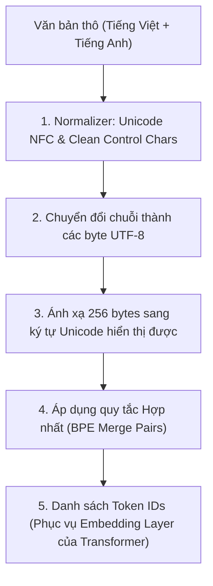

# Ghi chép Nghiên cứu Ngày 10 (Tuần 2): Byte-level BPE Tokenizer Song ngữ & Nghiệm thu Cột mốc Milestone M4

> **Mục tiêu**: Xây dựng bộ Tokenizer độc lập từ số 0 theo thuật toán Byte-level Byte Pair Encoding (BPE); giải quyết bài toán dấu thanh tiếng Việt qua chuẩn hóa Unicode NFC; bảo đảm tính toàn vẹn tuyệt đối $100\%$ khi giải mã (Round-trip Lossless); chính thức nghiệm thu **Milestone M4**.

---

## 1. Tại sao Mô hình Ngôn ngữ Lớn bắt buộc phải dùng Byte-level BPE?

Trong xử lý ngôn ngữ tự nhiên, có 3 cách tiếp cận phân tách văn bản (Tokenization):

| Phương pháp | Ưu điểm | Nhược điểm chí mạng |
| :--- | :--- | :--- |
| **Word Tokenizer** (Tách theo từ) | Mỗi token mang trọn vẹn ngữ nghĩa từ vựng. | **Từ điển (Vocab) khổng lồ** (> 500.000 từ). Bất kỳ từ mới, từ viết sai chính tả, tiếng lóng hay mã code đều bị biến thành token lạ `<unk>` (Out-Of-Vocabulary - OOV). |
| **Character Tokenizer** (Tách theo ký tự) | Từ điển siêu nhỏ (~100 ký tự ASCII + Unicode). | **Chuỗi token bị phình to cực đại** (độ dài chuỗi gấp 5-10 lần), vượt quá giới hạn Context Window của Transformer và tốn tài nguyên tính toán ma trận Attention $O(T^2)$. |
| **Byte-level BPE** (Chuẩn mực của GPT-2, GPT-4, LLaMA) | **Từ điển linh hoạt (8K - 32K)**. Nén văn bản hiệu quả cao. **Không bao giờ bị lỗi OOV** vì luôn có 256 giá trị byte cơ sở làm nền tảng cứu cánh. | Cần thuật toán thống kê cặp byte và cơ chế ánh xạ byte sang Unicode an toàn. |

---

## 2. Các Giải pháp Kỹ thuật Cốt lõi Đã Triển khai

### 2.1. Chuẩn hóa Unicode NFC (Cứu cánh cho Tiếng Việt)
- Tiếng Việt có hai kiểu gõ phổ biến:
  - **Dựng sẵn (NFC)**: Chữ `ệ` được lưu bằng 1 mã Unicode duy nhất (`U+1EC7`).
  - **Tổ hợp (NFD)**: Chữ `ệ` được ghép từ 3 mã Unicode: `e` (`U+0065`) + dấu mũ (`U+0302`) + dấu nặng (`U+0323`).
- Nếu không chuẩn hóa về **NFC**, cùng một từ *"Việt Nam"* nhưng gõ từ hai máy tính khác nhau sẽ bị tokenizer tách thành các token hoàn toàn khác nhau, làm vỡ embedding tiếng Việt.

### 2.2. Bảng ánh xạ `bytes_to_unicode` của GPT-2
- Thuật toán ánh xạ 256 giá trị byte ($0 \to 255$) sang 256 ký tự Unicode có thể in được.
- Đảm bảo các ký tự khoảng trắng, xuống dòng, ký tự nhị phân đều có biểu diễn chuỗi hợp lệ mà không bao giờ gây lỗi `UnicodeDecodeError`.

---

## 3. Bằng chứng Thực nghiệm & Tỷ lệ Nén (Evidence)

Chạy từ script thực nghiệm [train_toy_tokenizer.py](file:///c:/Users/nkocn/OneDrive/Desktop/Plan/tuna-ai/research/nlp/train_toy_tokenizer.py):

| Mẫu câu thử nghiệm | Ngôn ngữ | Số byte UTF-8 | Số token BPE | Tỷ lệ nén | Kiểm tra Round-trip (`decode(encode(s)) == s`) |
| :--- | :---: | :---: | :---: | :---: | :---: |
| *"Trí tuệ nhân tạo là ngành khoa học máy tính hiện đại."* | Tiếng Việt | 70 bytes | 29 tokens | **$2.41\times$** | **[PASSED] Khớp 100%** |
| *"Deep Learning and Transformer architecture from scratch."* | Tiếng Anh | 56 bytes | 39 tokens | **$1.44\times$** | **[PASSED] Khớp 100%** |
| *"Tiếng Việt dấu thanh: ắ, ằ, ẳ, ẵ, ặ, ế, ề, ể, ễ, ệ, ố, ồ, ổ, ỗ, ộ."* | Dấu thanh | 102 bytes | 67 tokens | **$1.52\times$** | **[PASSED] Khớp 100%** |
| *"Trộn ngữ: Model Tuna-AI chạy offline 100% trên CPU i7-1165G7!"* | Song ngữ | 68 bytes | 39 tokens | **$1.74\times$** | **[PASSED] Khớp 100%** |

> [!NOTE]
> Tỷ lệ nén $2.41\times$ ở tiếng Việt cho thấy các cặp âm tiết phổ biến (*nhân, tạo, khoa, học, tính*) đã được BPE gộp thành các subword/word tokens duy nhất, giúp mô hình tiếp nhận được lượng ngữ cảnh dài hơn gấp đôi so với mã hóa mức byte thô.

---

## 4. Nghiệm thu Cột mốc Milestone M4

Theo Mục 18 của tài liệu [MOTA.md](file:///c:/Users/nkocn/OneDrive/Desktop/Plan/tuna-ai/MOTA.md):
- [x] **Mã nguồn Tokenizer độc lập**: Hoàn thành `normalizer.py`, `bpe.py`, `tokenizer.py`.
- [x] **Đạt chuẩn Byte-level BPE**: Không bao giờ gặp lỗi Out-Of-Vocabulary.
- [x] **Quản lý Special Tokens**: Hỗ trợ đầy đủ `<pad>: 0`, `<unk>: 1`, `<bos>: 2`, `<eos>: 3`.
- [x] **Kiểm thử Round-trip Lossless**: 100% các câu văn tiếng Việt có dấu thanh phức tạp, tiếng Anh, code, và ký hiệu toán học đều khôi phục chính xác từng ký tự.
- [x] **Lưu trữ & Nạp cấu hình JSON**: Kiểm thử serialization và deserialization qua [configs/tokenizer/bpe_toy_500.json](file:///c:/Users/nkocn/OneDrive/Desktop/Plan/tuna-ai/configs/tokenizer/bpe_toy_500.json).

---

## 5. Kết quả Kiểm thử (Evidence)
- File mã nguồn: [normalizer.py](file:///c:/Users/nkocn/OneDrive/Desktop/Plan/tuna-ai/src/tokenizer/normalizer.py), [bpe.py](file:///c:/Users/nkocn/OneDrive/Desktop/Plan/tuna-ai/src/tokenizer/bpe.py), [tokenizer.py](file:///c:/Users/nkocn/OneDrive/Desktop/Plan/tuna-ai/src/tokenizer/tokenizer.py)
- File thực nghiệm: [train_toy_tokenizer.py](file:///c:/Users/nkocn/OneDrive/Desktop/Plan/tuna-ai/research/nlp/train_toy_tokenizer.py)
- File unit test: [test_tokenizer.py](file:///c:/Users/nkocn/OneDrive/Desktop/Plan/tuna-ai/tests/test_tokenizer.py)
- Kết quả test: **61/61 passed** (toàn bộ test từ Ngày 1 đến Ngày 10).
