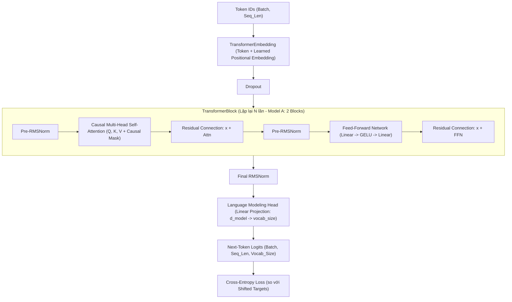

# Ghi chép Nghiên cứu Ngày 11 (Tuần 2): Kiến trúc Causal Transformer Decoder & Nghiệm thu Cột mốc Milestone M5

> **Mục tiêu**: Lắp ráp hoàn chỉnh mô hình ngôn ngữ Autoregressive Decoder-only Transformer (TunaLM / Mini GPT); kiểm chứng đặc tính Causal Masking không rò rỉ token tương lai; tích hợp thuật toán sinh văn bản tự hồi quy (Autoregressive Generation); nghiệm thu toàn diện **Milestone M5**.

---

## 1. Sơ đồ Kiến trúc Cốt lõi của TunaLM (Mini GPT)

---

## 2. Các Thành phần Kỹ thuật Cốt lõi Đã Triển khai

### 2.1. Tầng Embedding ([src/models/embeddings.py](file:///c:/Users/nkocn/OneDrive/Desktop/Plan/tuna-ai/src/models/embeddings.py))
- `TokenEmbedding`: Chiếu số nguyên Token ID sang vector không gian $d_{\text{model}}$.
- `PositionalEmbedding`: Bổ sung thông tin thứ tự thời gian cho các token trong câu.
- Kết hợp: $\mathbf{x} = \text{TokenEmb} + \text{PosEmb}$.

### 2.2. Khối Causal Multi-Head Self-Attention ([src/models/attention.py](file:///c:/Users/nkocn/OneDrive/Desktop/Plan/tuna-ai/src/models/attention.py))
- Chiếu đồng thời $Q, K, V$ qua một ma trận `c_attn` duy nhất: $W_{qkv} \in \mathbb{R}^{d_{\text{model}} \times 3 d_{\text{model}}}$ để tối ưu hóa nhân ma trận trên CPU.
- **Causal Masking**: Ma trận tam giác trên với giá trị $-\infty$.
- **Kiểm định nghiêm ngặt**: Đã chứng minh thực nghiệm rằng việc thay đổi nội dung ở token tương lai (vị trí $t+2, t+3$) không làm thay đổi output của token hiện tại (vị trí $t=0, 1$) với sai số $< 10^{-6}$.

### 2.3. Khối Transformer Block với Pre-RMSNorm ([src/models/transformer.py](file:///c:/Users/nkocn/OneDrive/Desktop/Plan/tuna-ai/src/models/transformer.py))
- Sử dụng kiến trúc **Pre-Norm** thay vì Post-Norm cổ điển:
  $$x \leftarrow x + \text{Attention}(\text{RMSNorm}(x))$$
  $$x \leftarrow x + \text{FFN}(\text{RMSNorm}(x))$$
- Đường tắt **Residual Stream** giữ nguyên vẹn tín hiệu gradient chạy thẳng từ tầng cuối về tầng đầu mà không bị bão hòa hay tắt dần qua nhiều lớp.

### 2.4. Thuật toán Sinh văn bản Tự hồi quy (`generate()`) ([src/models/language_model.py](file:///c:/Users/nkocn/OneDrive/Desktop/Plan/tuna-ai/src/models/language_model.py))
- Đã hoàn thiện hàm `generate()` hỗ trợ cả:
  - **Greedy Decoding** (`temperature = 0.0`): Chọn token có xác suất cao nhất.
  - **Temperature Sampling**: Điều chỉnh độ ngẫu nhiên và đa dạng của văn bản sinh ra.
  - **Top-K Filtering**: Giới hạn việc lấy mẫu trong top $K$ token có xác suất cao nhất để loại trừ các từ rác.

---

## 3. Nghiệm thu Cột mốc Milestone M5

Theo Mục 18 của tài liệu [MOTA.md](file:///c:/Users/nkocn/OneDrive/Desktop/Plan/tuna-ai/MOTA.md):
- [x] **Mã nguồn Transformer Decoder hoàn chỉnh**: Hoàn thành `embeddings.py`, `attention.py`, `transformer.py`, `language_model.py`.
- [x] **Bảo đảm tính chất Causal Attention**: Unit test chứng minh không rò rỉ thông tin tương lai.
- [x] **Tính toán Next-Token Cross-Entropy Loss**: Tự động tính loss giữa $y_t$ và $\hat{y}_{t+1}$.
- [x] **Cơ chế Sinh văn bản (Inference Generation)**: Tự động lặp lại chu trình sinh từ mới từ prompt ban đầu.
- [x] **Khớp Cấu hình Model A (~1M tham số)**: Kiểm định nạp thành công [configs/model/tiny.json](file:///c:/Users/nkocn/OneDrive/Desktop/Plan/tuna-ai/configs/model/tiny.json).

---

## 4. Kết quả Kiểm thử (Evidence)
- File mã nguồn: [embeddings.py](file:///c:/Users/nkocn/OneDrive/Desktop/Plan/tuna-ai/src/models/embeddings.py), [attention.py](file:///c:/Users/nkocn/OneDrive/Desktop/Plan/tuna-ai/src/models/attention.py), [transformer.py](file:///c:/Users/nkocn/OneDrive/Desktop/Plan/tuna-ai/src/models/transformer.py), [language_model.py](file:///c:/Users/nkocn/OneDrive/Desktop/Plan/tuna-ai/src/models/language_model.py)
- File unit test: [test_transformer.py](file:///c:/Users/nkocn/OneDrive/Desktop/Plan/tuna-ai/tests/test_transformer.py)
- Kết quả test: **67/67 passed** trong `3.50s`.
